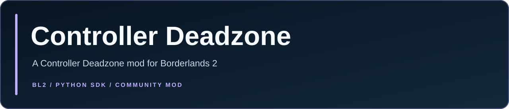

  <a href="#features">Features</a> ·
  <a href="#installation">Installation</a> ·
  <a href="#usage">Usage</a> ·
  <a href="#compatibility">Compatibility</a> ·
  <a href="#documentation">Documentation</a>

---

## Features

- Customize the left and right controller stick deadzones independently.
- Choose **Axial** (separate X/Y thresholds) or **Radial** (circular thresholds) processing.
- Adjust inner and outer deadzone limits and prioritize keyboard/mouse input when switching devices.
- Optionally enable C++ input processing; standard Python processing remains available.

## Installation

1. Install [PythonSDK and Willow2 Mod Manager](https://bl-sdk.github.io/willow2-mod-db/).
2. Close Borderlands 2 and back up your existing `sdk_mods/ControllerDeadzone/` folder and saved SDK settings.
3. Download the matching **Player ZIP** from the [Releases page](https://github.com/PeytonBlakeslee/ControllerDeadzone/releases), then extract its `ControllerDeadzone/` folder into `Borderlands 2/sdk_mods/`. Remove duplicate installations.
4. Confirm `sdk_mods/ControllerDeadzone/__init__.py`, then launch the game and enable **Controller Deadzone Control** in the SDK Mods menu.

**Download:** Use the matching Player ZIP on the [Releases page](https://github.com/PeytonBlakeslee/ControllerDeadzone/releases). If no public download is listed, publication is still pending. GitHub's automatic source ZIP is not an installable Player package.

See the [user guide](mod/ControllerDeadzone/README.md#installation) for updates, rollback, and troubleshooting.

## Usage

1. Choose **Enable Radial Deadzone** (default) or **Enable Axial Deadzone**. The two modes are mutually exclusive.
2. Open **Axial Settings** or **Radial Settings** to configure each stick.
3. Find **Keyboard & Mouse Priority**, **Controller Wake**, and the optional native backend under **General → Advanced Settings**.

See [settings and defaults](mod/ControllerDeadzone/README.md#setup-and-defaults).

## Compatibility

**Windows Borderlands 2** is the primary Player target. The Pre-Sequel is experimental; co-op and Proton/Wine are unverified. Native Linux BL2 is unsupported by this package.

**TPS safety:** The optional **Native Input Backend (Experimental)** is Off by default and may cause input problems or crash the game. Leave it Off unless you accept that risk. [Compatibility and recovery details](docs/COMPATIBILITY.md).

## Documentation

[User guide](mod/ControllerDeadzone/README.md) · [Compatibility](docs/COMPATIBILITY.md) · [Troubleshooting](mod/ControllerDeadzone/README.md#troubleshooting) · [Building](BUILDING.md) · [Changelog](CHANGELOG.md) · [Report an issue](https://github.com/PeytonBlakeslee/ControllerDeadzone/issues) · [MIT license](LICENSE) · [Third-party notices](THIRD_PARTY_NOTICES.md)

---

Other Borderlands 2 mods

- [No Warp Tunnel](https://github.com/PeytonBlakeslee/NoWarpTunnel)
- [Auto Pickup](https://github.com/PeytonBlakeslee/AutoPickup)
- [Loot Recovery](https://github.com/PeytonBlakeslee/LootRecovery)
- [Controller Manager](https://github.com/PeytonBlakeslee/ControllerManager)
- [OmniMovement](https://github.com/PeytonBlakeslee/OmniMovement)

